# FloorCube · 户型魔方

上传一张户型图照片，AI 识别墙体 / 门窗 / 房间，逐步生成可旋转、可试摆家具的 **3D 房间小模型沙盘**。
零注册：模型接口地址、API Key 与户型数据保存在你自己的浏览器本地。

> 2026 Qoder 高校创造力大赛 · LifeHack 生活娱乐赛道参赛作品（赛题 532536）。

**在线体验**：<https://floorcube-a12rwkjcvum.qoder.zone>（无需注册，可体验内置示例）

> 以下截图与功能说明对应 **2026-11-20 版本**，已重新发布到上述线上地址。流式识别截图来自模拟接口回归，不代表真实模型的速度或准确率。

## 界面预览

<table>
  <tr>
    <td>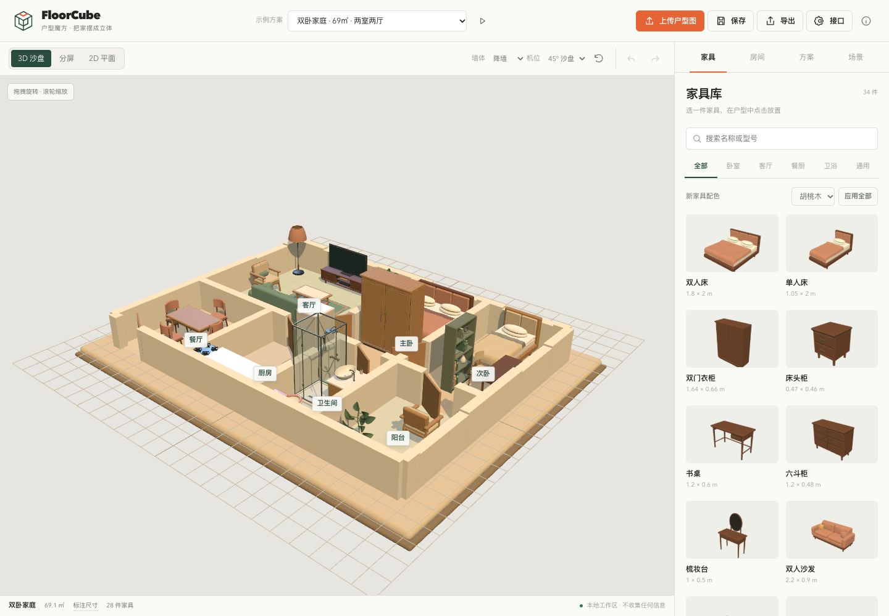</td>
    <td>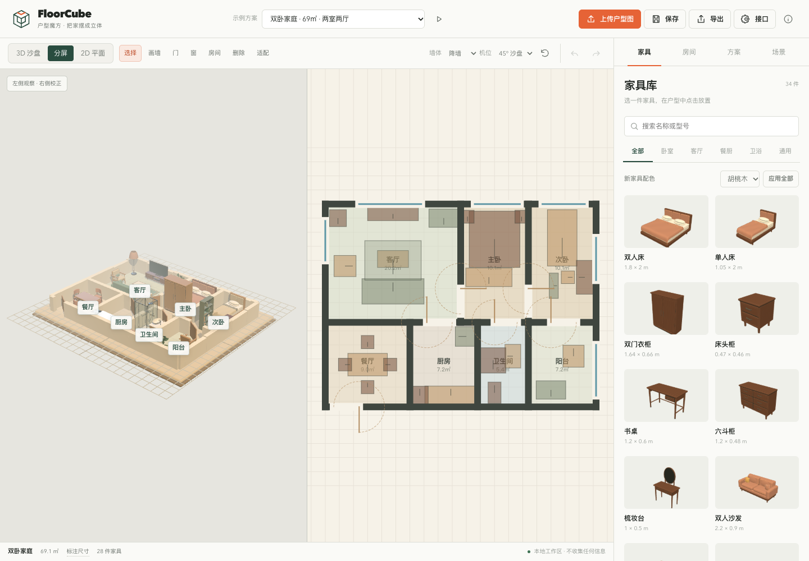</td>
  </tr>
  <tr>
    <td align="center">桌面沙盘：房间标签、降墙模式与 34 件精细化家具</td>
    <td align="center">分屏校正：左侧 3D 与右侧 2D 实时同步</td>
  </tr>
  <tr>
    <td>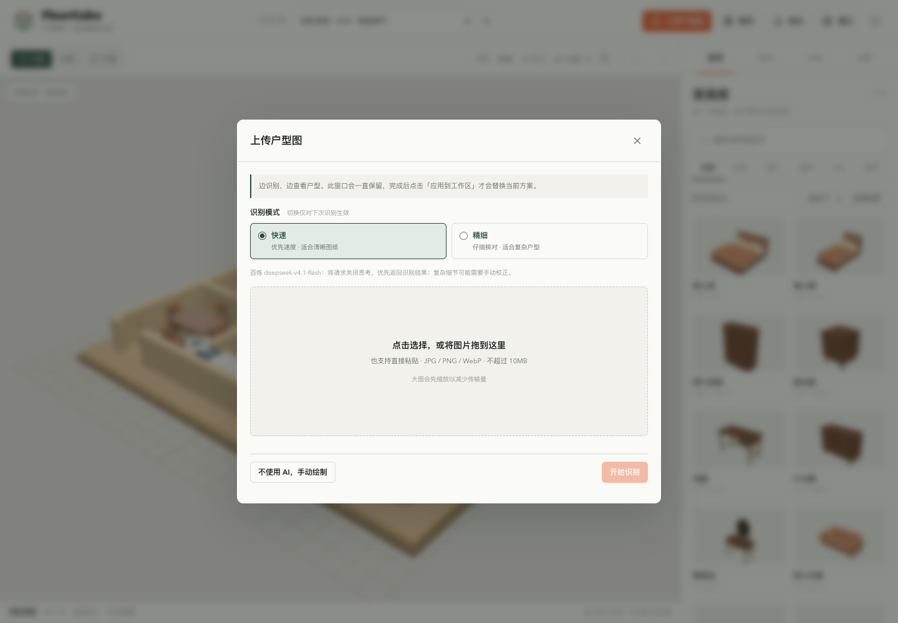</td>
    <td>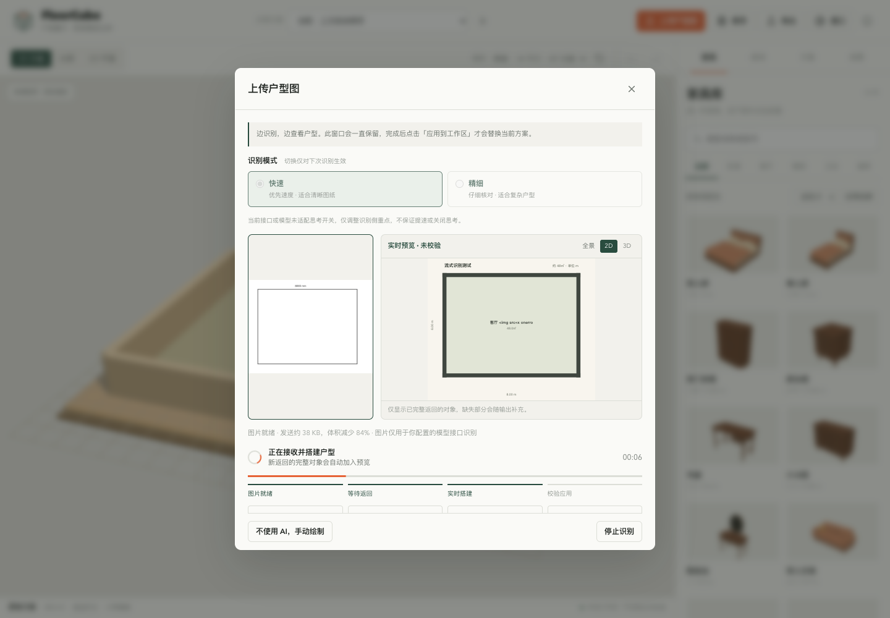</td>
  </tr>
  <tr>
    <td align="center">上传户型图：快速 / 精细可选，也可直接手动绘制</td>
    <td align="center">流式预览：完整对象逐步累加，展示实际收到的数量（模拟响应）</td>
  </tr>
  <tr>
    <td>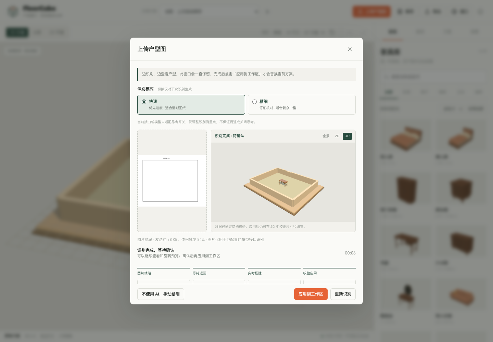</td>
    <td align="center">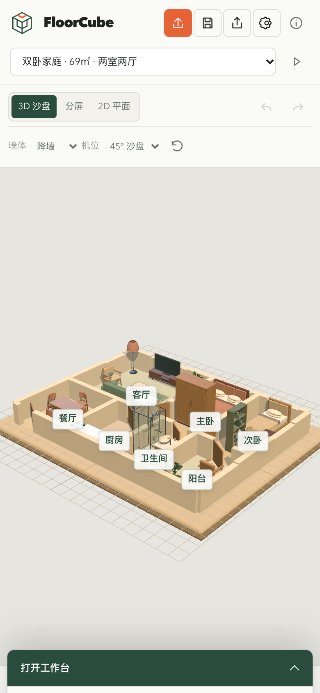</td>
  </tr>
  <tr>
    <td align="center">完成后等待确认：点击“应用到工作区”才替换方案（模拟响应）</td>
    <td align="center">移动端：双行顶栏与底部工作台抽屉</td>
  </tr>
</table>

### 模拟识别：四步都有对应画面

无需 Key 或模型请求。使用同一套内置户型依次展示 **示例图纸 → 结构提取 → 尺寸与置信度 → 3D 沙盘**，不是把同一张图片配上轮播文字；第四步直接显示可旋转的 3D 预览。

<table>
  <tr>
    <td>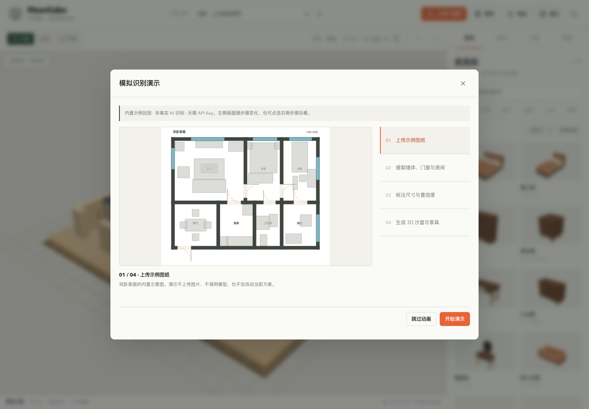</td>
    <td>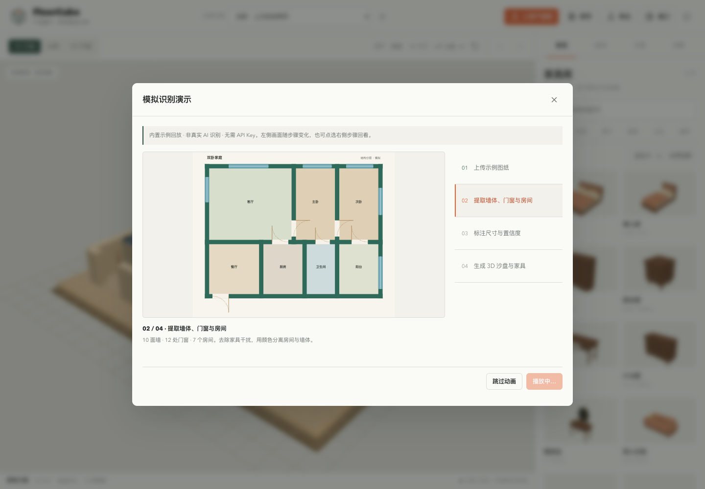</td>
  </tr>
  <tr>
    <td align="center">01 图纸：展示所选户型的内置示意图</td>
    <td align="center">02 结构：去除家具轮廓，分离墙体和房间</td>
  </tr>
  <tr>
    <td>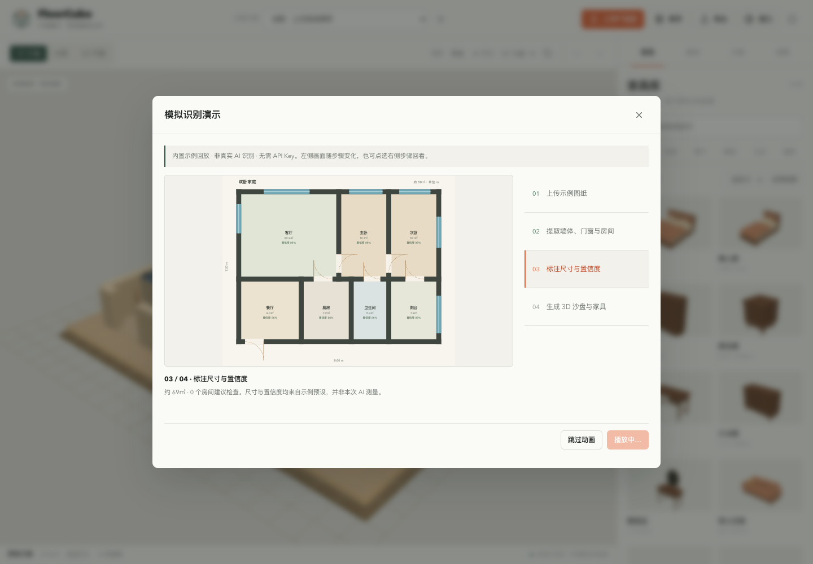</td>
    <td>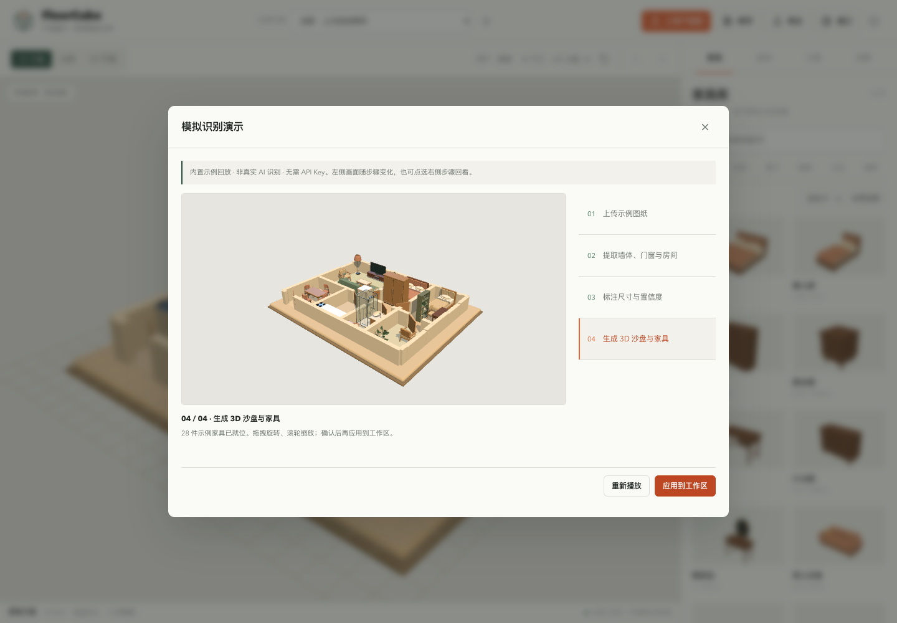</td>
  </tr>
  <tr>
    <td align="center">03 标注：面积、尺寸及低置信度检查提示均来自示例预设</td>
    <td align="center">04 沙盘：可旋转查看，确认后应用到工作区</td>
  </tr>
</table>

可点选任意步骤回看、重新播放或跳过动画。播放和关闭都不会覆盖当前方案；只有点击“应用到工作区”才载入示例。

### 家具细节

<table>
  <tr>
    <td>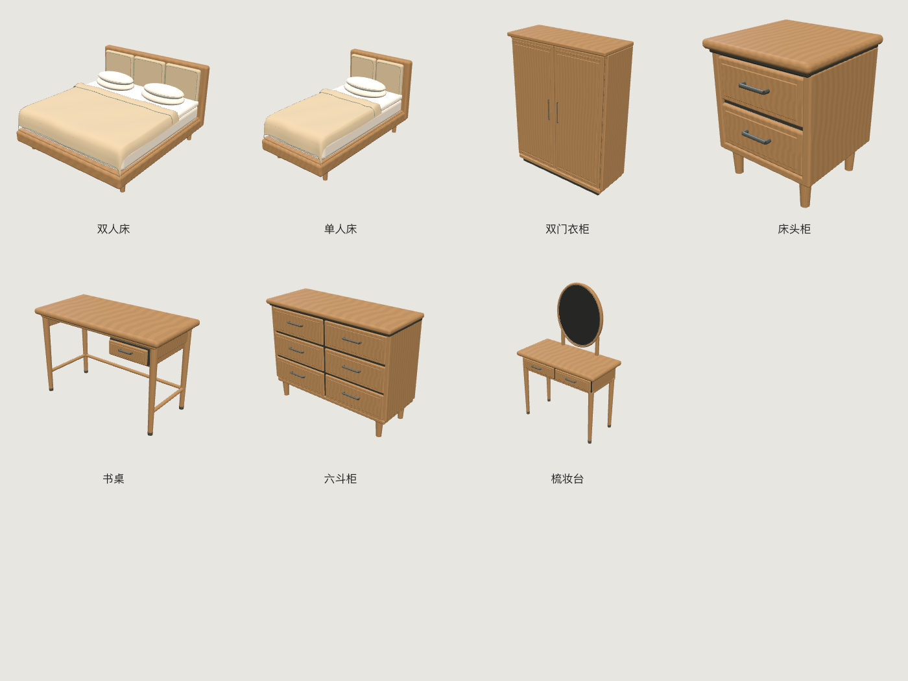</td>
    <td>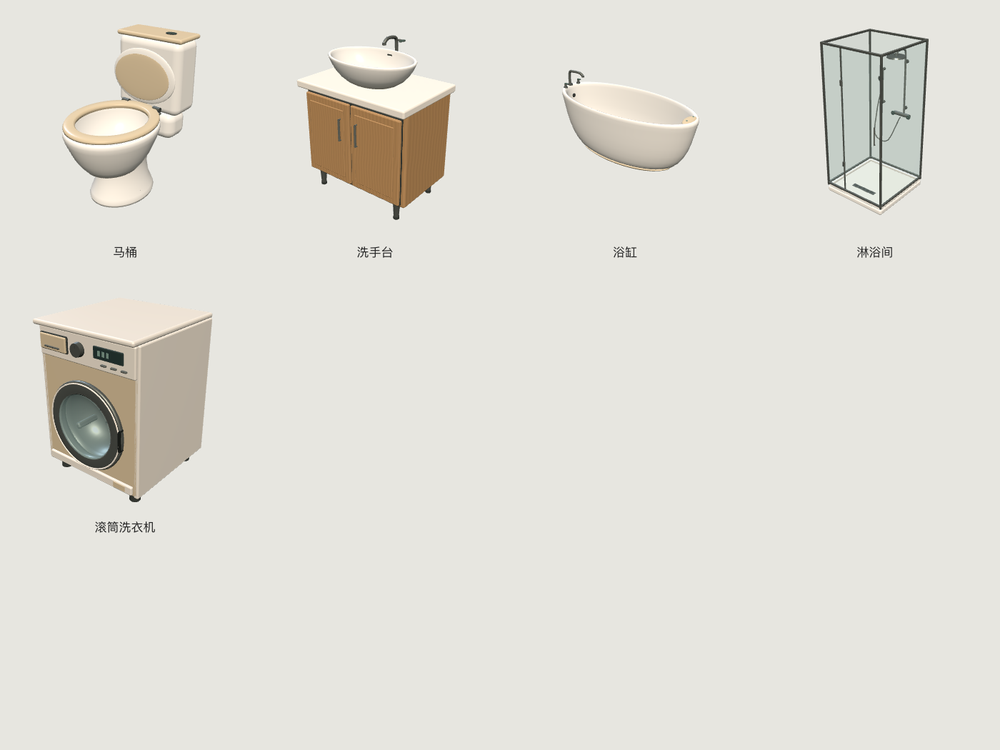</td>
  </tr>
  <tr>
    <td align="center">卧室：床品、软包、柜门与五金</td>
    <td align="center">卫浴：内凹器具、陶瓷材质与滚筒细节</td>
  </tr>
</table>

## 核心体验

- **AI 流式识别**：上传 / 拖拽 / 粘贴照片 → 视觉模型输出户型 JSON → 浏览器 Three.js 本地建模。只展示完整且校验通过的墙体、房间、门窗和家具；实时显示接收数量与耗时，不把推理内容当识别结果。非流式接口会明确提示整包返回。
- **连续的预览与确认**：隔离的 2D / 3D 预览不会写入当前方案；更新时保留用户视角，完成后等待确认应用。可停止、手动重试，或在已有有效墙体和房间时使用部分结果继续校正。
- **快速 / 精细模式**：快速适合清晰图纸，精细侧重复杂结构与朝向核对；已适配的接口使用原生思考开关，未知模型明确提示仅调整识别侧重点。未实测真实模型的提速幅度和准确率差异。
- **上帝斜俯视 3D 沙盘**：拖拽旋转 / 滚轮缩放，45° / 俯视 / 正面机位；降墙 / 实体 / 半透明三种墙体模式；暖色主光 + 冷色轮廓光、静态阴影按需更新。
- **34 件程序化家具**：涵盖卧室、客厅、餐厨、卫浴与通用物件；全部新旧模型细化圆角、软包、床品、柜门、五金和材质。家具库支持搜索 / 分类，放置、移动、旋转、复制、删除、换色与按房间智能布置。
- **摆放约束与 2D 校正**：家具边界、碰撞、门内通行区与高频朝向校验；画墙 / 门 / 窗 / 房间、网格与正交吸附，2D / 3D 同步，无 Key 也能从零描绘。
- **尺寸校准**：按已知总面积或单墙实际长度等比缩放结构，家具保持真实物理尺寸。
- **保存与导出**：localStorage 自动保存、多方案管理、撤销重做、JSON 导入导出、带水印 PNG 截图。
- **零配置可玩**：4 套内置户型与可回看的四步模拟识别，无需 Key 即可体验示例和编辑功能。

## BYOK 与隐私

FloorCube 不要求注册，也不收集用户配置用于运营；使用你自己的 API Key 调用视觉模型：

- 模型选项为 **DeepSeek Flash / 用户自定义**；接口选项为 **阿里云百炼官方 / DeepSeek 官方 / 用户自定义**。新配置默认 DeepSeek Flash + DeepSeek 官方；已有配置与自定义草稿保留，Key 必须来自所选服务商。
- 百炼接口下的 Flash 预设实际请求 `deepseek-v4.1-flash`，配置窗口会展示实际请求型号；快速使用 `enable_thinking: false`，精细使用 `enable_thinking: true` + `reasoning_effort: high`，不改写已保存的模型名。
- Base URL / API Key / 模型名均可自定义；服务商、地域、模型和 CORS 限制以实际接口为准，可先“测试连接”检查图像输入能力。
- 配置与户型数据仅存浏览器 localStorage；图片在浏览器解码、优化后只用于发往你配置的模型接口的识别请求。
- 仅首次直连网络 / CORS 失败可退回**无状态转发**（仅 HTTPS、拒绝内网地址、不记录或存储 Key 与地址）。HTTP 错误、流中断、解析失败和取消不会自动重试模型调用。
- 识别输出有正文、单事件、缓冲、总流量与时间限制；模型返回的名称按纯文本处理。

<p align="center">
  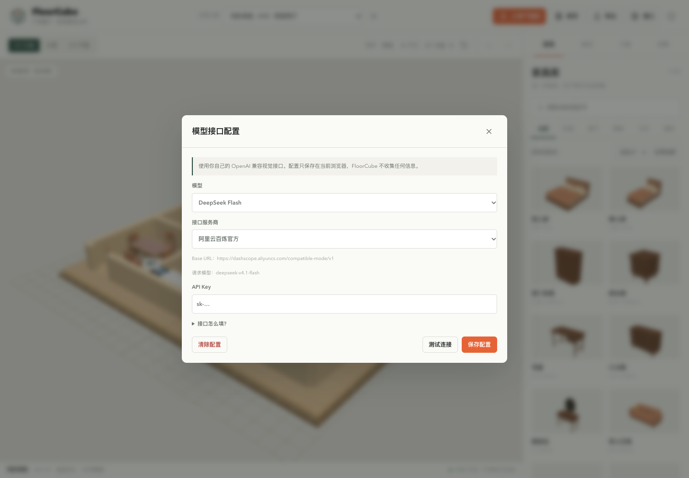
  <br />
  <sub>接口与模型独立选择，百炼预设展示实际请求型号；保存前可测试连接</sub>
</p>

## 快速开始

```bash
npm install
npm run dev      # http://127.0.0.1:5173
```

无需 Key：直接编辑内置示例，或点击顶栏播放按钮体验四步模拟识别。
真实识别：填写模型配置 → 上传户型图 → 选择快速 / 精细 → 开始识别 → 查看增量预览 → 确认应用到工作区。

```bash
npm test                          # Vitest 单元测试
npm run build                     # TypeScript 严格检查与生产构建
node scripts/screenshot.mjs        # 截图与模拟演示浏览器回归，输出到 screenshots/
node scripts/e2e-streaming.mjs     # 模拟接口的流式 / 配置 / 模式回归，无真实模型调用
node scripts/e2e-recognition.mjs   # 真实识别回归；需 DEEPSEEK_KEY，可能产生费用
```

浏览器脚本需要本机 Chrome 与运行在 `127.0.0.1:5173` 的开发服务器。截图使用隔离浏览器，不读取日常浏览器中的 Key。

## 技术栈

Vite + TypeScript（strict）+ Three.js + Canvas 2D，原生 UI 无框架依赖；Vitest 与 Puppeteer 回归。
工作区由单一 PlanStore 驱动 3D / 2D / 侧栏 / 状态栏，识别与演示预览使用隔离状态；pixelRatio 封顶 2、几何与材质复用、阴影按需更新。

## 目录

```
src/
  ai/        视觉模型客户端、SSE 解析、供应商参数适配与开发转发
  core/      Schema / 几何 / 碰撞 / 布局 / 状态store / 本地存储
  models/    34 件程序化家具模型与缩略图
  scene/     Three.js 3D 沙盘
  editor/    Canvas 2D 校正编辑器
  ui/        应用外壳、弹窗、四步模拟演示与交互
  data/      内置户型与分层 SVG 平面图
functions/   生产环境无状态流式转发
scripts/     截图与端到端回归脚本
screenshots/ 项目内截图存档（保留历史版本）
AI使用过程记录.md  完整 AI 协作开发过程记录
```

## 许可

见 [LICENSE](./LICENSE)。
