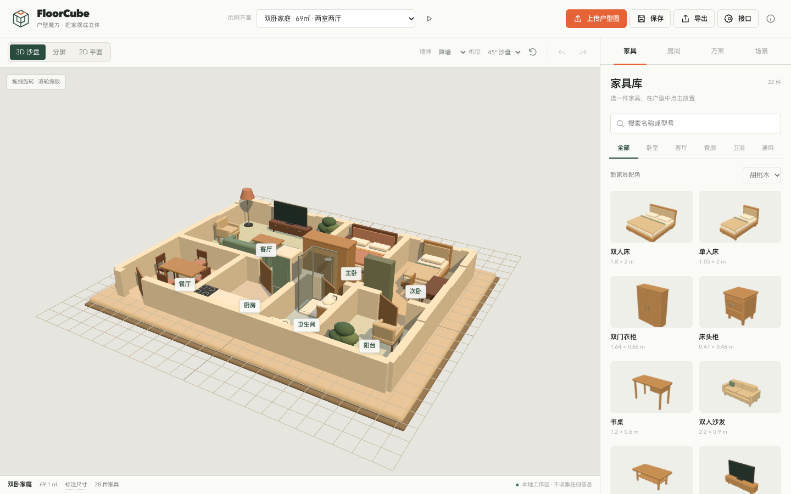
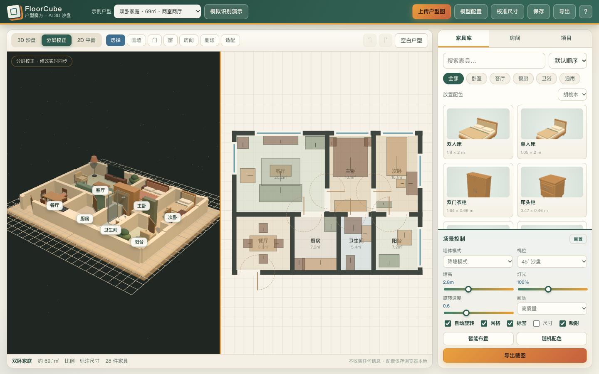
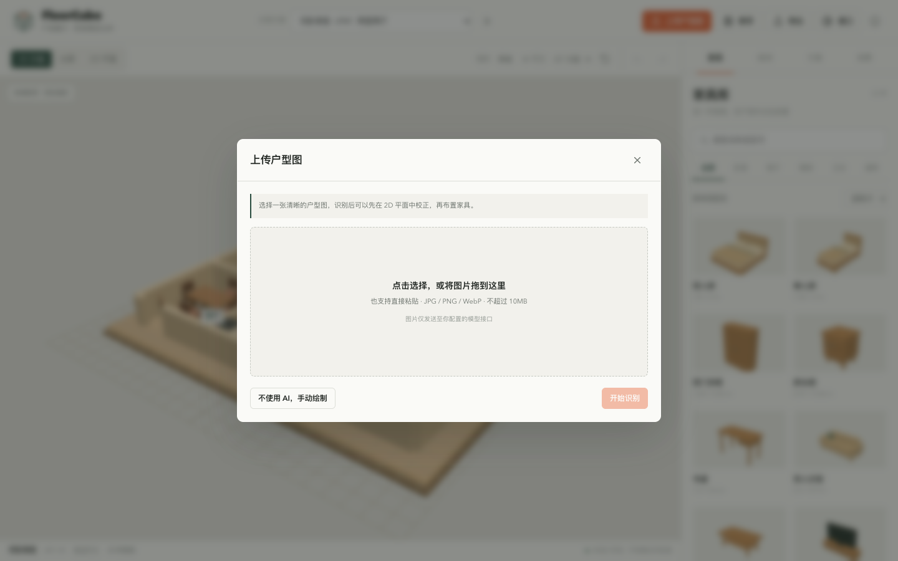
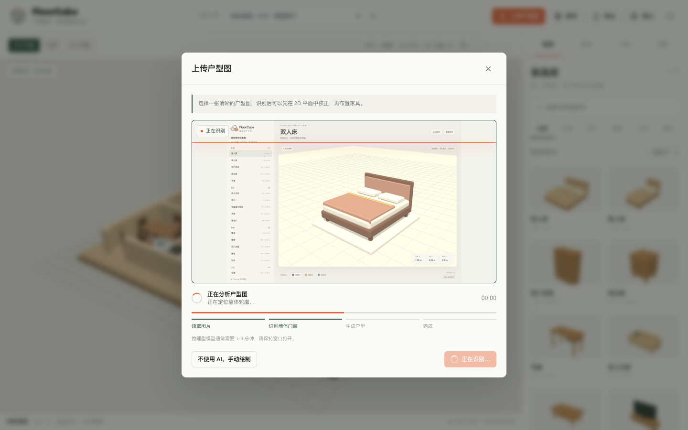
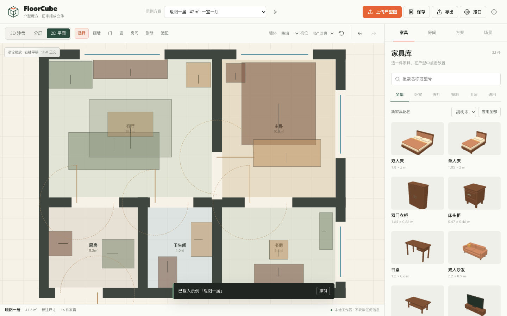
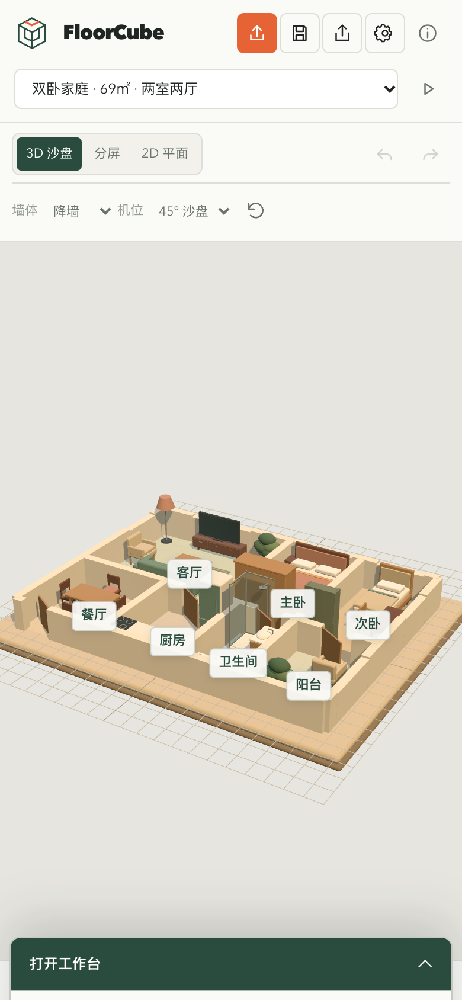
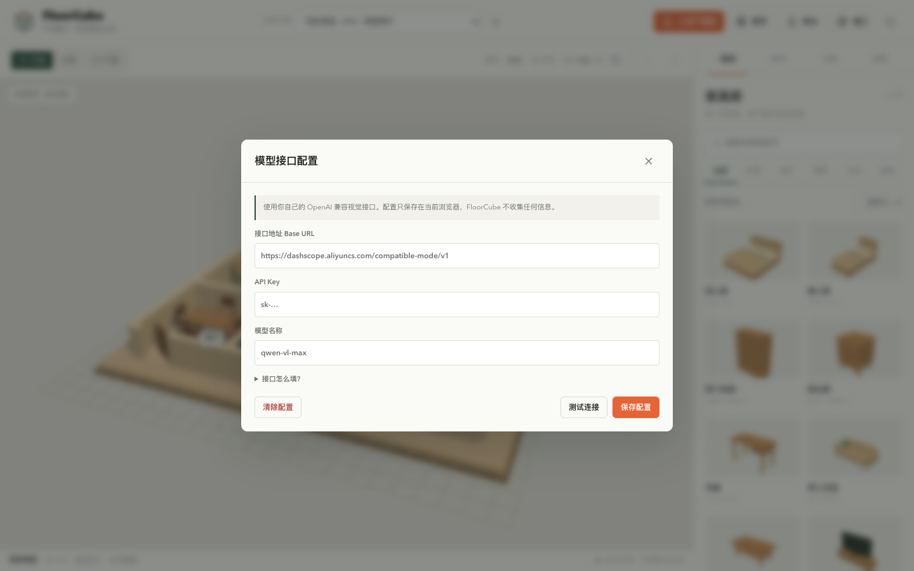

# FloorCube · 户型魔方

上传一张户型图照片，AI 识别墙体 / 门窗 / 房间，即时生成可旋转、可试摆家具的 **3D 房间小模型沙盘**。
零注册、零收集：模型接口地址、API Key 与户型数据只保存在你自己的浏览器本地。

> 2026 Qoder 高校创造力大赛 · LifeHack 生活娱乐赛道参赛作品（赛题 532536）。

## 界面预览

<table>
  <tr>
    <td></td>
    <td></td>
  </tr>
  <tr>
    <td align="center">桌面端 3D 沙盘：房间标签、降墙模式与 22 件家具库</td>
    <td align="center">分屏模式：左侧 3D 与右侧 2D 校正实时双向同步</td>
  </tr>
  <tr>
    <td></td>
    <td></td>
  </tr>
  <tr>
    <td align="center">上传户型图：选择 / 拖拽 / 粘贴，也可跳过 AI 手动绘制</td>
    <td align="center">AI 识别：读取图片 → 识别门窗 → 生成户型，阶段可回看</td>
  </tr>
  <tr>
    <td></td>
    <td align="center"></td>
  </tr>
  <tr>
    <td align="center">2D 校正：墙体、门窗、房间与家具朝向、门内通行区校验</td>
    <td align="center">移动端：双行顶栏与底部工作台抽屉</td>
  </tr>
</table>

## 核心体验

- **AI 识别建模**：上传 / 拖拽 / 粘贴户型图照片 → 视觉模型输出结构化 JSON → 自动生成 3D 沙盘与 2D 平面；低置信度区域高亮「建议检查」；可读取图中明确家具，并在生成前校正堵门、重叠与高频家具朝向。
- **上帝斜俯视 3D 沙盘**：阻尼轨道相机拖拽旋转 / 滚轮缩放，45° 沙盘 / 俯视 / 正面机位；降墙 / 实体 / 半透明三种墙体模式；暖色主光 + 冷色轮廓光、静态阴影按需更新。
- **家具试摆**：22 件程序化低模家具（缩略图库支持搜索 / 分类），点击或拖拽放置、拖动、旋转、复制、删除、换色；OBB 碰撞、房间边界与门内通行区实时校验，无效位置变红回弹；按房间类型一键智能布置。
- **2D 校正编辑器**：画墙 / 门 / 窗 / 房间 / 删除 / 选择，网格与正交吸附，与 3D 实时双向同步；无 Key 也能从零手动描绘。
- **尺寸校准**：按已知总面积或单墙实际长度等比缩放结构，家具保持真实物理尺寸。
- **保存与分享**：localStorage 自动保存、多方案管理、JSON 导入导出、带水印 PNG 截图导出。
- **零配置可玩**：4 套内置示例户型 + 模拟识别回放，评委无 Key 也能完整体验全部交互。

## BYOK 与隐私

FloorCube **不收集任何信息**，只是让你通过自己的 API Key 调用模型：

- 接口地址 Base URL、API Key、模型名三项完全开放（默认预填阿里云百炼，但不绑定），任意 OpenAI 兼容视觉接口均可：Qwen-VL、DeepSeek-Flash、GPT-4o、GLM-4V、Moonshot、Ollama……
- 配置与户型数据仅存浏览器 localStorage；照片只发送到你配置的那个接口、仅用于那一次识别调用。
- 浏览器直连被 CORS 拦截时，退化为**无状态转发**（仅 HTTPS、不记录不存储 Key 与地址）。
- 推理型模型（如 deepseek-flash）自动适配 reasoning 预算与 effort 参数；输出解析具备代码块剥离、截断补全、尾逗号清理与自动纠正重试。

<p align="center">
  
  <br />
  <sub>模型接口配置：Base URL、API Key、模型名均可自定义，保存前可先「测试连接」</sub>
</p>

## 快速开始

```bash
npm install
npm run dev      # http://127.0.0.1:5173
```

打开页面 → 「模型配置」填入 Base URL / API Key / 模型名（可先「测试连接」预检图像能力）→ 「上传户型图」→ 开始 AI 识别。
不配置 Key 也可以直接玩示例户型、手动描绘与全部编辑功能。

```bash
npm test         # Vitest 单元测试（模型 / 几何 / 碰撞 / 解析 / 状态）
npm run build    # 生产构建
node scripts/screenshot.mjs        # 无头 Chrome 存档截图（需本机 Chrome）
node scripts/e2e-recognition.mjs   # 真实识别全链路回归（DEEPSEEK_KEY 环境变量传入）
```

## 技术栈

Vite + TypeScript（strict）+ Three.js + Canvas 2D，原生 UI 无框架依赖；Vitest 单元测试。
单一 PlanStore 状态源驱动 3D / 2D / 侧栏 / 状态栏；单一 requestAnimationFrame 渲染循环；pixelRatio 封顶 2；几何与材质复用；阴影静态烘焙按需更新。

## 目录

```
src/
  ai/        视觉模型客户端（BYOK / 解析加固 / 重试）、无状态转发处理
  core/      Schema / 几何 / 碰撞 / 布局 / 状态store / 本地存储
  models/    22 件程序化家具模型与缩略图
  scene/     Three.js 3D 沙盘
  editor/    Canvas 2D 校正编辑器
  ui/        应用外壳与全部弹窗 / 交互
  data/      内置示例户型
scripts/     截图与端到端回归脚本
screenshots/ 过程截图存档
AI使用过程记录.md  完整 AI 协作开发过程记录
```

## 许可

见 [LICENSE](./LICENSE)。